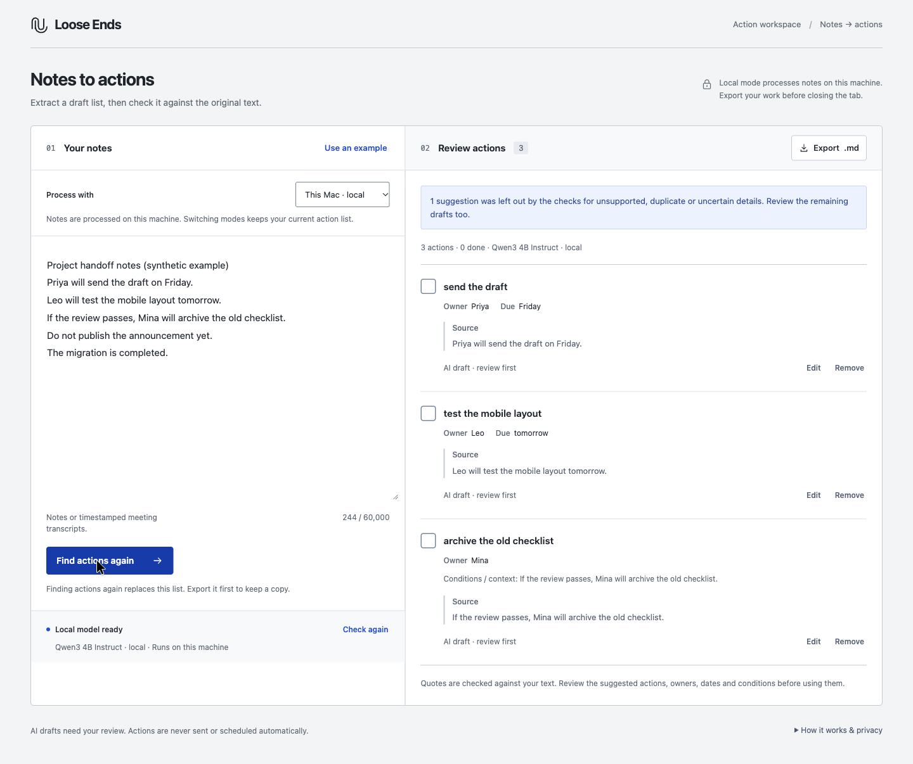

# Loose Ends

Turn scattered notes into an editable action list, with the source kept beside
every task. Choose an open-weight model on your own machine or explicitly select
optional Groq-hosted GPT-OSS 120B. It does not send messages, schedule tasks or
act on your behalf.

Built for Hacktoberfest 2026 Week 3, **Slow and Steady**.



[Watch the local-model demo](https://tgoyal63.github.io/loose-ends/) ·
[See release evidence and limits](docs/release.md)

The October 22 release demonstrates the ordinary-notes workflow. Long-meeting
extraction remains incomplete: the latest hosted natural-meeting run found nine
of ten expected actions and failed acceptance. Review every draft against its
source. See [the hosted validation report](docs/hosted-validation.md).

## Run

The web application needs Python 3.11 or later and no third-party Python packages.
Local inference uses a separate model process. For hosted setup without a local
model download, run `python3 server.py` using Python 3.11+, open the local app,
select **Hosted · Groq**, and use the password field to configure a dedicated
Groq API key. See [hosted processing](docs/hosted-processing.md) for data handling,
account setup and the remaining live acceptance checks.

For local inference:

1. Start the pinned local model using [the runtime instructions](docs/model-runtime.md).
2. Use the exact model ID returned by that service's `GET /v1/models` endpoint:

   ```bash
   .model-venv/bin/python server.py \
     --model-base-url http://127.0.0.1:62141/v1 \
     --model 'YOUR_ADVERTISED_MODEL_ID' \
     --model-label 'Qwen3 4B Instruct · local'
   ```

3. Open **http://127.0.0.1:62140**.

The command uses the Python environment created by the MLX runtime instructions;
an existing Python 3.11+ installation also works for the application.

Paste notes or a timestamped meeting transcript, up to 60,000 characters.
For ordinary notes, keep each action and its conditions on one line.
Transcripts with a `Speaker Name HH:MM:SS` header followed by that person's
utterance are recognized automatically. Keep speaker names, timestamps and
the complete exchanges; wrapped speech is supported.

The whole supported input is sent to the selected model. Local requests with
completed invalid formatting can be retried once automatically, within the same
150-second overall deadline. Hosted requests have no automatic retry.
Conversation text is never silently shortened. Pasting
over the limit keeps the text and shows an error; it is not silently truncated.
Load the labelled synthetic example to try the ordinary notes flow without
personal data. Review the drafts, edit or remove tasks, then export Markdown.
Editing a task keeps its original source evidence and marks it as human-edited.

Local mode requires an OpenAI-compatible model server with streamed chat
completions; it does not require an API key. Hosted mode uses Groq's API and may
consume paid credit. This project does not use the OpenAI service or silently
fall back between local and hosted processing.
The example runtime uses MLX on Apple silicon; other compatible loopback servers
can be configured explicitly. Verify their response format and model IDs.

## What the checks establish

The model identifies potential actions and returns structured text. For ordinary
notes, the validator requires an entire original source line, at most 1,200
characters, with verbatim title and attribution. Detected conditional tasks
retain the complete line.

For transcripts, the model selects a stable turn ID. The server attaches the
complete original turn, its speaker and timestamp, and an exact surrounding
excerpt containing up to two turns on either side. Whitespace normalization
allows wrapped action text; it does not allow invented quotations or rewritten
titles. Speaker attribution requires support for the selected action, rather
than assuming that every action mentioned belongs to the person speaking.
Nearby conversation is reviewable in the interface and retained in the export.

These checks reduce unsupported output. They do **not** prove every task follows
from its source, detect every form of negation, recover context from every earlier
paragraph, or find every valid action. The model reads the full transcript, but
later corrections and cancellations still need human review; an attached nearby
excerpt may not contain a distant qualification. Relative dates remain relative.
A missing owner or date stays unknown. Up to 20 drafts are returned. Human review
is part of the workflow.

## Privacy and boundaries

- The app and local model listen on loopback only; no public deployment is required.
- Fresh pages default to local mode. Hosted processing must be selected explicitly
  and sends the complete submitted source to Groq. Switching modes never submits it.
- The app keeps notes, drafts and edits in browser/request memory until export;
  hosted provider handling is separate and described in the hosted guide.
- API keys stay in server process memory. The app clears the password field
  on submission and does not store the key in files or browser storage.
- The application does not store notes, use analytics, load a CDN or write request
  contents to access logs.
- Export creates a local file. Closing/reloading the page clears the unsaved draft.
- The separately configured model service has its own behavior; inspect its
  logging and settings before using sensitive material.
- Model output and pasted content render as text, not HTML.
- Requests from another website are rejected. The local client rejects remote
  URLs and credentials; the separate hosted client uses only Groq's fixed HTTPS
  endpoint. Neither client follows redirects or environment proxies.

## Validate

```bash
.model-venv/bin/python -m unittest discover -s tests -v
node --check web/app.js
```

With both local services running, evaluate five synthetic source-fidelity cases:

```bash
python3 scripts/evaluate_model.py --output logs/model-evaluation.json
```

Exercise fragmented speech, separate speakers, long transcripts, natural
conversation, and later cancellation through the running local application:

```sh
python3 scripts/evaluate_transcripts.py --output logs/transcript-evaluation.json
```

To evaluate an explicitly configured hosted model, add `--mode hosted` to either
evaluator. This submits synthetic fixtures to Groq and may consume API credit;
the expected actions and source checks are identical in both modes.

This is a small reproducible check, not a universal model benchmark. Real model
results and browser evidence are recorded separately from tests using a fake
model. See [release validation](docs/release.md) for measured results,
including the unresolved accuracy failure on a longer natural meeting.

## Open development

Application code is MIT licensed. The selected model retains its own license;
model provenance, revision and runtime package versions belong in
[model-runtime.md](docs/model-runtime.md). The weights are not bundled here.

AI agents assisted with implementation, tests and documentation. The contest
article must disclose its actual authorship separately. No claimed personal
experience, performance result or milestone credit should be inferred from this
repository.
